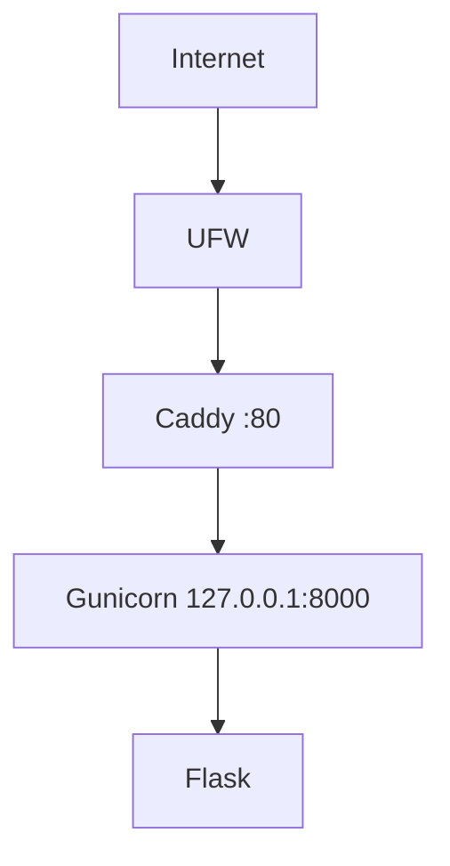
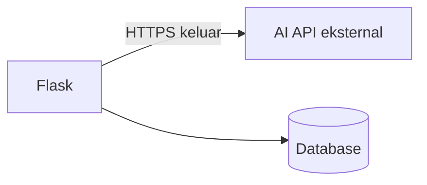

# Architecture v0.1

## Deployment View (M03, sudah berjalan)

## Planned Extension (belum diimplementasikan)

- Flask memanggil AI API eksternal untuk menghasilkan rekomendasi resep dari bahan dan preferensi pengguna.
- API key AI disimpan di environment server, bukan di repository.
- Pilihan database (SQLite atau layanan terkelola) diputuskan pada M05.

## Resource Constraints
- Acuan modul: 1 vCPU, 1 GB RAM, 20 GB disk
- VPS aktual: 2 vCPU, 2 GB RAM, 20 GB disk, 1 GB swap
- Gunicorn dikonfigurasi 1 worker dan 2 thread (konservatif, mengikuti batas modul)
- Model AI tidak dijalankan di VPS; panggilan ke AI API bersifat I/O-bound

## Security Decisions
- non-root administration
- SSH key authentication
- password SSH disabled
- root login disabled
- UFW enabled (hanya SSH dan HTTP)
- backend loopback-only

## Current Limitations
- HTTP only
- single VPS
- no AI integration
- no database
- no container
- no CI/CD

## Planned Evolution
- M04 DNS + HTTPS
- M05 persistent data + integrasi AI API
- M06 container
- M07 IaC
- M09 CI/CD
